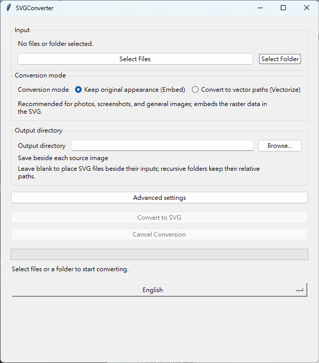

# SVGConverter

[](https://github.com/KageRyo/SVGConverter/actions/workflows/ci.yml)
[](https://sonarcloud.io/summary/new_code?id=KageRyo_SVGConverter)
[](https://sonarcloud.io/component_measures?id=KageRyo_SVGConverter&metric=coverage)
[](https://pypi.org/project/svgconverter/)
[](https://pypi.org/project/svgconverter/)
[](LICENSE)

[正體中文](README_TW.md)

SVGConverter converts PNG, JPEG, WebP, BMP, and TIFF images to SVG through a
small Python API, command-line interface, and desktop GUI.

## At a glance

| Interface | Best for | Highlights |
| --- | --- | --- |
| Python API | Application integration and automation | Single files, mixed batches, metrics, progress, and cancellation |
| CLI | Scripts and repeatable workflows | Files, directories, recursion, output directories, and optimization |
| Desktop GUI | Interactive conversion | Both modes, conversion options, progress, and cancellation |

## Choose a conversion mode

```text
Raster image
    │
    ├── embed ─────> SVG <image> (pixels preserved by default)
    └── vectorize -> SVG <path>  (optional VTracer backend)
```

| Goal | Recommended mode | What to expect |
| --- | --- | --- |
| Preserve pixels, especially for photographs | `embed` | A self-contained SVG with an embedded raster; the default keeps the original raster bytes, while Base64 adds some overhead |
| Create editable paths from logos, icons, or line art | `vectorize` | VTracer-generated SVG paths; the result depends on tracing options and input complexity |
| Need both faithful and path-based output | Run both modes | They produce different representations; `embed` is not a substitute for vectorization |

### Representative inputs

| Input | `embed` | `vectorize` | Suggested choice |
| --- | --- | --- | --- |
| Photograph | Faithful pixels; size follows the source raster plus SVG/Base64 overhead | May become larger and stylized | `embed` |
| Logo or icon | Faithful raster appearance | Often a good path candidate; size depends on tracing settings | `vectorize` when editable paths are needed |
| High-contrast line art | Exact raster appearance | Usually a good path candidate | Choose based on fidelity versus editability |

## Conversion modes

- **`embed`** (default) places the original raster bytes in an SVG `<image>`
  element. It preserves the source pixels, but it is not vectorization and can
  be larger than the original image because of Base64 encoding. TIFF is the
  exception: most browsers cannot display it, so its first page is embedded as
  a lossless PNG instead.
- **`vectorize`** traces raster regions into SVG paths using the optional
  [VTracer](https://github.com/visioncortex/vtracer) backend. It is most useful
  for logos, icons, illustrations, and high-contrast line art. Photographs can
  produce large, stylized output rather than a faithful smaller image.

## Installation

SVGConverter requires Python 3.10 or newer:

```bash
python -m pip install --upgrade svgconverter
```

Install vectorization support when needed:

```bash
python -m pip install --upgrade "svgconverter[vectorize]"
```

To run the current development version instead:

```bash
git clone https://github.com/KageRyo/SVGConverter.git
cd SVGConverter
python -m pip install .
```

## Command line

Convert one image, retaining its dimensions in the generated SVG:

```bash
svgconverter image.png
svgconverter photo.jpg --output output.svg
svgconverter logo.png --mode vectorize --vectorize-color-mode binary
```

To keep the source filename in a different directory:

```bash
svgconverter photo.jpg --output-dir ./svg-output
```

This creates `svg-output/photo.svg` and uses the same summary and overwrite
rules as batch conversion. An existing output is skipped with exit code 0;
`--overwrite` replaces it. A conversion failure returns exit code 1. `--output`
selects an explicit filename for one input file and cannot be combined with
`--output-dir`.

Convert all supported images immediately inside a directory:

```bash
svgconverter ./images --output-dir ./svg-output
```

Include nested directories while retaining their relative paths under the
output directory:

```bash
svgconverter ./images --output-dir ./svg-output --recursive
```

Convert several explicit files in one batch. Shells that support glob expansion
can also expand patterns such as `./images/*.png` before invoking the command:

```bash
svgconverter image.png photo.jpg --output-dir ./svg-output
```

For batch conversion, existing output SVGs are skipped unless `--overwrite` is
supplied; the final summary reports converted, skipped, and failed items.
Supported inputs are PNG, JPG, JPEG, WebP, BMP, TIF, and TIFF (including
upper-case extensions). Run `svgconverter --help` for all options. Vectorize
mode requires the optional `vectorize` extra.

When a wrapper passes paths from an untrusted user or agent, add
`--allowed-root ./workspace` to restrict resolved input and output paths to that
directory. Existing symlinks that resolve outside the boundary are rejected.
Without this option, the local CLI keeps its normal ability to access
user-selected filesystem locations.

### JSON reports for automation

Add `--json` to single-file or batch commands to emit one structured report:

```bash
svgconverter ./images --output-dir ./svg-output --json > report.json
```

Reports include per-file paths, failures, skips, sizes, totals, and cancellation
state. Exit status remains `0` for success/skips and `1` for conversion errors;
invalid arguments use stderr and exit `2`. See the [versioned JSON schema and
shell automation example](docs/json-reports.md) for compatibility and error rules.

### Embed optimization

Embed mode preserves the source raster bytes by default. Opt in to resizing or
re-encoding only when a smaller raster payload is worth the quality trade-off:

```bash
svgconverter photo.jpg --max-width 1600 --jpeg-quality 82
svgconverter illustration.png --png-compress-level 9 --optimize-png
```

`--max-width` and `--max-height` only downscale and preserve aspect ratio.
`--jpeg-quality` applies only to JPEG inputs; `--png-compress-level` and
`--optimize-png` apply only to PNG inputs, so the same batch options are safe
for mixed formats. A resized JPEG without an explicit quality uses 95. The CLI
reports input, embedded-raster, and SVG sizes after each conversion or batch.
These controls apply to `embed` mode only.

Animated WebP and APNG retain their original bytes, including frames and timing,
when no raster changes are needed. Resizing either format, or applying PNG
compression/optimization to APNG, raises `ConversionError` instead of silently
discarding animation. Remove those options to embed the animation unchanged.
Larger size limits and options for other formats leave the bytes unchanged.
In a batch, an unsupported animated conversion is reported as a per-file failure
and remaining images continue; the CLI returns exit code 1 and the GUI shows the
failure details. Animation playback depends on the SVG viewer.

### Vectorize presets

Choose a starting point for VTracer, then override individual controls if needed:

```bash
svgconverter logo.png --mode vectorize --vectorize-preset logo
svgconverter icon.png --mode vectorize --vectorize-preset icon --vectorize-curve-mode spline --filter-speckle 0
```

The same names and descriptions appear in the GUI's Vectorize preset selector.
Selecting a preset fills the advanced fields; you can edit them before converting.
Changing the language or switching modes keeps those edits. Selecting another
preset replaces the tracing fields with that preset's values.

| Preset | Color / hierarchy / curves | Speckle / color bits / layer difference / path decimals | Intended use and trade-off |
| --- | --- | --- | --- |
| `default` | color / stacked / spline | unset / unset / unset / unset | Existing behavior; try mixed image types first |
| `logo` | color / stacked / spline | 4 / 8 / 16 / 3 | Smooth colored logos; retains fine color detail but can remove tiny regions |
| `icon` | color / cutout / polygon | 2 / 8 / 8 / 2 | Angular icons with sharp corners; curves can look polygonal |
| `line-art` | binary / stacked / spline | 2 / unset / unset / 3 | High-contrast black-and-white drawings; discards color and tiny speckles |
| `illustration` | color / stacked / spline | 4 / 6 / 16 / 3 | Smooth illustrations; merges similar colors for simpler paths |

Unset numeric settings use VTracer's defaults. `default` is exactly
`VectorizeOptions()` and is used when no preset is selected. Explicit CLI options
override a preset, including zero values and choices equal to the usual defaults.
Tracing quality depends on the input; these presets do not promise exact shape
recreation or smaller files. Inspect the result before relying on it.

## Python API

```python
from svgconverter import (
    ConversionProgress,
    EmbedOptions,
    SVGConverter,
    convert_file,
    convert_file_with_metrics,
    convert_paths,
    vectorize_preset,
)

convert_file("image.png", "image.svg")
convert_file("logo.png", "logo.svg", mode="vectorize")
convert_file(
    "icon.png",
    "icon.svg",
    mode="vectorize",
    vectorize_options=vectorize_preset("icon", curve_mode="spline", filter_speckle=0),
)
convert_file("workspace/image.png", allowed_root="workspace")

converter = SVGConverter(overwrite=True)
result = converter.convert_directory("./images", "./svg-output", recursive=True)
metric = convert_file_with_metrics(
    "photo.jpg",
    "photo.svg",
    embed_options=EmbedOptions(max_width=1600, jpeg_quality=82),
)


def report(progress: ConversionProgress) -> None:
    print(progress.completed, progress.total, progress.input_path)


batch = convert_paths(
    ["logo.png", "photo.jpg"], "./svg-output", progress_callback=report
)
print(batch.success_count, batch.skipped_count, batch.failure_count)
print(metric.input_bytes, metric.embedded_raster_bytes, metric.svg_bytes)
```

`convert_file()` returns the output `pathlib.Path`. Directory conversion returns
a `BatchResult` containing successful output paths and per-file failures, so a
bad image does not abort the entire batch. `convert_paths()` accepts a mix of
files and directories; existing batch outputs are recorded as skips unless
`overwrite=True` is selected. `EmbedOptions` is opt-in; without it, embed mode
uses the original raster bytes. `convert_file_with_metrics()` and
`BatchResult.metrics` report source, embedded-raster, and SVG byte sizes.
Use `progress_callback` for each processed item; return `True` from
`should_cancel` to stop cleanly before the next item. The result then has
`cancelled=True`.

`vectorize_preset(name, **overrides)` returns a `VectorizeOptions` object. Override
names are its field names; `None` resets an optional numeric field to the backend
default. Unknown preset names raise `ValueError` with the supported names.

Without `overwrite=True`, a completed SVG is published with an atomic hard link
so concurrent converters cannot replace each other's output. A collision raises
`OutputExistsError` and is recorded as a per-file batch failure. When hard links
are unsupported, Windows uses non-replacing rename, Linux uses
`renameat2(RENAME_NOREPLACE)`, and macOS uses `renamex_np(RENAME_EXCL)`. If neither
operation is available, conversion fails without publishing a partial SVG.
Network-share atomicity depends on the server's implementation and has not been
verified. With `overwrite=True`, atomic replacement is retained.

For integrations that accept untrusted path values, pass `allowed_root` to
`convert_file()`, `convert_file_with_metrics()`, `convert_directory()`,
`convert_paths()`, or `SVGConverter`. The converter resolves paths and rejects
inputs, outputs, and symlink escapes outside that directory. The default
`allowed_root=None` preserves the local library behavior.

## GUI



Install the package and run:

```bash
svgconverter-gui
```

To enable optional file and folder dropping in a Python installation:

```bash
python -m pip install --upgrade "svgconverter[gui]"
```

Drop supported images or folders onto the outlined target. Dropped items are
added to the current selection, duplicate paths are removed, and paths with
spaces or Unicode are supported. Unsupported or inaccessible items are listed
while valid items remain selected. Dropping only selects inputs: choose the
conversion settings and click **Convert to SVG** to start. Drops during an active
conversion are refused; folder recursion follows the existing setting.

Drag and drop uses the optional `tkinterdnd2` native extension. It needs a working
Tkinter installation and a compatible bundled tkdnd library for the OS and CPU.
The current extension requires Tcl/Tk 8.x; Tcl/Tk 9 builds can fall back to the
selection buttons. If the extra is missing or its native library cannot load,
the GUI identifies drag and drop as unavailable and the file/folder pickers
remain usable. Windows standalone builds include the extension; Linux/macOS
Python installations depend on their local Tk/native-library compatibility.

The legacy development command `python main.py` starts the same GUI. Select one
or more files, or a folder, to convert with visible non-blocking progress and a
converted/skipped/failed summary. You can cancel between files; any per-file
errors are shown after the batch without closing the application. The mode choices
are described by their expected result: **Keep original appearance (Embed)** is
recommended for photos, screenshots, and general images, while **Convert to vector
paths (Vectorize)** is recommended for logos, icons, illustrations, and
high-contrast line art. The GUI offers Traditional Chinese, English, and Japanese,
plus the following conversion settings:

- Select `embed` or `vectorize` mode; the first choice embeds raster data in an SVG
  `<image>`, while the second traces the image into SVG `<path>` elements.
- Choose an output directory, overwrite existing SVG files, and optionally
  include nested folders.
- Expand **Advanced settings** when needed to configure embed resizing, JPEG quality,
  PNG compression, PNG optimization, and common vectorize options. The GUI explains
  pixel dimensions, JPEG quality (1–95), PNG compression (0–9), and the VTracer
  controls in place; blank numeric fields keep the backend defaults.

After a run, the result panel reports whether the batch completed, was skipped,
partially failed, or was cancelled, together with converted/skipped/failed counts.
It includes source and SVG sizes when metrics are available, identifies the output
location, and provides **Open output folder** and **Convert more images** actions.

When installed with Python, Vectorize mode requires the optional `vectorize`
extra, just like the CLI and Python API.

For a supported release, Windows users can download the standalone
`SVGConverter-vX.Y.Z-windows-x86_64.exe` asset from the GitHub Release page; it
includes the VTracer backend for both Embed and Vectorize and does not require
a local Python installation. For automated file conversion, prefix CLI options
with `--cli`, for example:

```powershell
.\SVGConverter-vX.Y.Z-windows-x86_64.exe --cli logo.png --mode vectorize --output logo.svg
```

The Windows build has no console window, so automation should check its exit code
and generated files; use the Python CLI when terminal output is needed.

Linux and macOS users should use the Python installation above. Public standalone
assets for these systems are deferred; the [native distribution evaluation](docs/native-distributions.md)
documents the tested targets, temporary CI artifacts and remaining runtime/signing
limitations.

## Contributing and license

See [CONTRIBUTING.md](CONTRIBUTING.md) for local checks and commit conventions.
This project is licensed under the [MIT License](LICENSE).

### Vector SVG compaction

Use `svgconverter logo.png --mode vectorize --optimize-svg` or pass
`VectorizeOptions(optimize_svg=True)` to the Python API. This opt-in removes
redundant XML indentation and whitespace around path commands. It never rounds
coordinates, changes tracing settings, or changes significant text. Output is
kept only when smaller; metrics reflect the final bytes. Conversion/optimization
failures leave existing SVGs intact. The default remains unoptimized.

Reductions are modest for VTracer's already compact markup. See the
[evaluation and rendering comparison](docs/svg-optimization.md) for measured
examples and scope. This setting is separate from Embed raster optimization.
