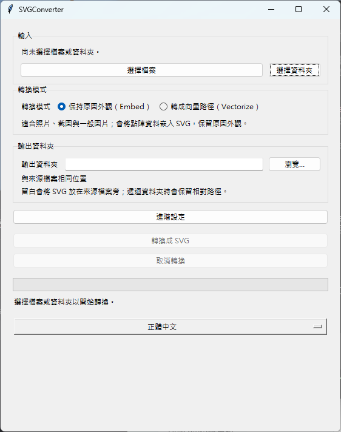

# SVGConverter

[](https://github.com/KageRyo/SVGConverter/actions/workflows/ci.yml)
[](https://sonarcloud.io/summary/new_code?id=KageRyo_SVGConverter)
[](https://sonarcloud.io/component_measures?id=KageRyo_SVGConverter&metric=coverage)
[](https://pypi.org/project/svgconverter/)
[](https://pypi.org/project/svgconverter/)
[](LICENSE)

[English](README.md)

SVGConverter 可將 PNG、JPEG、WebP、BMP、TIFF 影像轉為 SVG，並提供 Python API、
命令列工具與桌面 GUI。

## 快速了解

| 介面 | 適合情境 | 主要功能 |
| --- | --- | --- |
| Python API | 整合到應用程式與自動化流程 | 單檔、混合批次、大小 metrics、進度與取消 |
| 命令列工具 | Script 與可重複執行的流程 | 檔案、資料夾、遞迴、輸出資料夾與最佳化 |
| 桌面 GUI | 互動式轉換 | 兩種模式、轉換選項、進度與取消 |

## 選擇轉換模式

```text
點陣影像
    │
    ├── embed ─────> SVG <image>（預設保留像素）
    └── vectorize -> SVG <path> （選用 VTracer 後端）
```

| 目標 | 建議模式 | 你會得到什麼 |
| --- | --- | --- |
| 保留像素，尤其是照片 | `embed` | 自包含 SVG 與嵌入的點陣資料；預設保留原始 bytes，但 Base64 會增加一些大小 |
| 從 logo、icon 或線稿建立可編輯路徑 | `vectorize` | VTracer 產生的 SVG 路徑；結果取決於描繪選項與輸入複雜度 |
| 同時需要忠實影像與路徑版本 | 兩種模式都執行 | 兩者是不同表示方式；`embed` 不能取代向量化 |

### 代表性輸入

| 輸入 | `embed` | `vectorize` | 建議選擇 |
| --- | --- | --- | --- |
| 照片 | 忠實保留像素；大小取決於原始點陣資料再加上 SVG/Base64 額外負擔 | 可能變得更大且風格化 | `embed` |
| Logo 或 icon | 忠實保留點陣外觀 | 通常適合轉成路徑；大小取決於描繪選項 | 需要可編輯路徑時選 `vectorize` |
| 高對比線稿 | 保留原始點陣外觀 | 通常適合轉成路徑 | 依忠實度與可編輯性需求選擇 |

## 轉換模式

- **`embed`**（預設）把原始點陣資料放進 SVG 的 `<image>` 元素，能保留來源像素；但它不是
  向量化，且 Base64 編碼可能讓輸出大於原圖。TIFF 是例外：多數瀏覽器無法顯示 TIFF，因此會將
  第一頁以無損 PNG 嵌入。
- **`vectorize`** 使用選用的 [VTracer](https://github.com/visioncortex/vtracer) 後端，把
  點陣區域描繪為 SVG 路徑。它適合 logo、icon、插圖與高對比線稿；照片可能產生較大且風格化、
  不一定忠於原圖的結果。

## 安裝

SVGConverter 需要 Python 3.10 以上：

```bash
python -m pip install --upgrade svgconverter
```

需要實際向量化時，安裝額外相依：

```bash
python -m pip install --upgrade "svgconverter[vectorize]"
```

目前的開發版本可直接安裝：

```bash
git clone https://github.com/KageRyo/SVGConverter.git
cd SVGConverter
python -m pip install .
```

## 命令列

轉換單一檔案：

```bash
svgconverter image.png
svgconverter photo.jpg --output output.svg
svgconverter logo.png --mode vectorize --vectorize-color-mode binary
```

若要在其他資料夾保留來源檔名：

```bash
svgconverter photo.jpg --output-dir ./svg-output
```

此指令建立 `svg-output/photo.svg`，並使用與批次轉換相同的摘要與覆寫規則。
既有輸出會略過並回傳結束代碼 0；指定 `--overwrite` 才會覆寫。
轉換失敗會回傳結束代碼 1。`--output` 用於指定單一輸入檔的輸出檔名，
不能與 `--output-dir` 同時使用。

轉換資料夾最外層的所有支援影像：

```bash
svgconverter ./images --output-dir ./svg-output
```

遞迴轉換子資料夾，並在輸出資料夾中保留相對路徑：

```bash
svgconverter ./images --output-dir ./svg-output --recursive
```

一次轉換多個明確指定的檔案；支援萬用字元展開的 shell 也可以在執行前展開
`./images/*.png` 這類 pattern：

```bash
svgconverter image.png photo.jpg --output-dir ./svg-output
```

批次轉換時，除非指定 `--overwrite`，既有 SVG 輸出檔會列為略過；最後摘要會列出
轉換成功、略過與失敗數量。目前支援 PNG、JPG、JPEG、WebP、BMP、TIF、TIFF（含大寫副檔名）。
使用 `svgconverter --help` 可查看完整選項。`vectorize` 模式需要安裝選用的
`vectorize` extra。

如果 wrapper 會把不受信任的使用者或 agent 輸入直接傳成路徑，請加上
`--allowed-root ./workspace`，將解析後的輸入與輸出限制在該資料夾內；解析後落在邊界外的既有
symlink 也會被拒絕。不指定時，本機 CLI 仍保留存取使用者選定檔案位置的原有行為。

### 自動化 JSON 報告

在單檔或批次指令加上 `--json`，即可輸出一份結構化報告：

```bash
svgconverter ./images --output-dir ./svg-output --json > report.json
```

報告包含逐檔路徑、失敗、略過、大小、總計與取消狀態。成功／略過的結束代碼仍為 `0`，
轉換錯誤為 `1`；無效參數使用標準錯誤並回傳 `2`。
版本相容性、錯誤規則與 shell 範例請見 [JSON schema 文件](docs/json-reports.zh-TW.md)。

### embed 模式最佳化

`embed` 模式預設會保留原始點陣 bytes。只有在可接受品質取捨、希望縮小點陣 payload 時，才選擇
縮放或重新編碼：

```bash
svgconverter photo.jpg --max-width 1600 --jpeg-quality 82
svgconverter illustration.png --png-compress-level 9 --optimize-png
```

`--max-width` 與 `--max-height` 只會縮小，不會放大，且保留長寬比。`--jpeg-quality`
僅套用於 JPEG；`--png-compress-level` 與 `--optimize-png` 僅套用於 PNG，所以混合格式批次
可安全使用同一組選項。若縮放 JPEG 時未指定 quality，會使用 95。CLI 會在每次轉換或批次摘要中
顯示輸入、嵌入點陣與 SVG 的大小。這些選項只適用於 `embed` 模式。

動態 WebP 與 APNG 在不需要修改點陣資料時，會保留原始 bytes、影格與時間資訊。
若要求縮放這兩種格式，或對 APNG 套用 PNG 壓縮／最佳化，會回報 `ConversionError`，
避免無聲遺失動畫。移除這些選項即可原樣嵌入動畫；大於來源尺寸的縮放上限及其他格式專用選項
不會改動原始 bytes。批次轉換會將不支援的動畫處理列為個別檔案失敗，並繼續處理其餘影像；
CLI 會回傳結束代碼 1，GUI 會顯示失敗詳情。動畫能否播放仍取決於 SVG 檢視器。

### Vectorize 預設組合

先選擇適合影像的 VTracer 起點，再依需要覆寫個別選項：

```bash
svgconverter logo.png --mode vectorize --vectorize-preset logo
svgconverter icon.png --mode vectorize --vectorize-preset icon --vectorize-curve-mode spline --filter-speckle 0
```

GUI 的向量化預設組合選單提供相同名稱與對應說明。選擇後會填入進階設定欄位，轉換前仍可手動
修改；切換語言或轉換模式會保留修改。重新選擇預設組合時，會以該組合取代描繪欄位的值。

| 預設組合 | 色彩／階層／曲線 | 小區域／色彩位元／圖層差異／路徑小數位數 | 適用情境與取捨 |
| --- | --- | --- | --- |
| `default` | color / stacked / spline | 未設定／未設定／未設定／未設定 | 沿用既有行為，可先試用於混合類型影像 |
| `logo` | color / stacked / spline | 4 / 8 / 16 / 3 | 平滑彩色 Logo；保留較多色彩細節，但可能移除微小區域 |
| `icon` | color / cutout / polygon | 2 / 8 / 8 / 2 | 稜角分明的 Icon；保留銳利角落，曲線可能呈現折線 |
| `line-art` | binary / stacked / spline | 2／未設定／未設定／3 | 高對比黑白線稿；捨棄色彩並移除微小雜點 |
| `illustration` | color / stacked / spline | 4 / 6 / 16 / 3 | 平滑彩色插圖；合併相近顏色以簡化路徑 |

未設定的數值使用 VTracer 預設值。`default` 等同 `VectorizeOptions()`，未指定組合時沿用此行為。
明確指定的 CLI 選項會覆寫組合，包括 0 及與原本預設相同的選項值。描繪品質取決於輸入特性；
這些組合不保證完整重現形狀或縮小檔案，使用結果前請先檢視。

## Python API

```python
from svgconverter import (
    ConversionProgress,
    EmbedOptions,
    SVGConverter,
    convert_file,
    convert_file_with_metrics,
    convert_paths,
    vectorize_preset,
)

convert_file("image.png", "image.svg")
convert_file("logo.png", "logo.svg", mode="vectorize")
convert_file(
    "icon.png",
    "icon.svg",
    mode="vectorize",
    vectorize_options=vectorize_preset("icon", curve_mode="spline", filter_speckle=0),
)
convert_file("workspace/image.png", allowed_root="workspace")

converter = SVGConverter(overwrite=True)
result = converter.convert_directory("./images", "./svg-output", recursive=True)
metric = convert_file_with_metrics(
    "photo.jpg",
    "photo.svg",
    embed_options=EmbedOptions(max_width=1600, jpeg_quality=82),
)


def report(progress: ConversionProgress) -> None:
    print(progress.completed, progress.total, progress.input_path)


batch = convert_paths(
    ["logo.png", "photo.jpg"], "./svg-output", progress_callback=report
)
print(batch.success_count, batch.skipped_count, batch.failure_count)
print(metric.input_bytes, metric.embedded_raster_bytes, metric.svg_bytes)
```

`convert_file()` 會回傳輸出 `pathlib.Path`。資料夾轉換則回傳 `BatchResult`，其中包含成功檔案與
逐檔錯誤，單一壞檔不會使整批工作中斷。`convert_paths()` 可接收檔案與資料夾的混合輸入；
批次既有輸出預設列為略過，指定 `overwrite=True` 才會覆寫。`EmbedOptions` 為 opt-in；未設定時
embed 模式會使用原始點陣 bytes。`convert_file_with_metrics()` 與 `BatchResult.metrics` 會回報來源、
嵌入點陣與 SVG 的 byte 大小。
可使用 `progress_callback` 取得每個已處理項目；讓 `should_cancel` 回傳 `True`，即可在下一個檔案
開始前安全停止，結果的 `cancelled` 會是 `True`。

`vectorize_preset(name, **overrides)` 會回傳 `VectorizeOptions`。覆寫參數使用該資料類別的欄位名稱；
可將選用數值欄位設為 `None`，恢復使用後端預設值。未知的組合名稱會拋出 `ValueError`，
訊息中會列出支援名稱。

未指定 `overwrite=True` 時，完成的 SVG 會以原子性的 hard link 發布，避免並行轉換互相覆寫。
若發生衝突，會拋出 `OutputExistsError`，批次轉換則記錄為逐檔失敗。不支援 hard link 時，
Windows 使用不覆寫的 rename，Linux 使用 `renameat2(RENAME_NOREPLACE)`，macOS 使用
`renamex_np(RENAME_EXCL)`。兩種操作皆不可用時會回報錯誤，不會留下不完整的 SVG。
網路共享的原子性取決於伺服器實作，目前尚未驗證。指定 `overwrite=True` 時仍使用原子性取代。

如果整合程式會接受不受信任的路徑值，請對 `convert_file()`、`convert_file_with_metrics()`、
`convert_directory()`、`convert_paths()` 或 `SVGConverter` 傳入 `allowed_root`。Converter 會先解析路徑，
拒絕輸入、輸出以及 symlink 跳出該資料夾的情況。預設 `allowed_root=None` 會保留本機 library 的原有行為。

## GUI



安裝套件後執行：

```bash
svgconverter-gui
```

開發環境仍可用 `python main.py` 啟動相同 GUI。可選取一或多個檔案，或選擇一個資料夾；轉換時會以
非阻塞方式顯示進度與已轉換／略過／失敗摘要。可在檔案之間取消，個別檔案錯誤會在批次結束後顯示，
不會關閉應用程式。模式選項會直接說明結果：**保持原圖外觀（Embed）**適合照片、截圖與一般圖片；
**轉成向量路徑（Vectorize）**適合 Logo、Icon、插圖與高對比線稿。GUI 支援正體中文、English、日文，
並提供以下轉換設定：

- 選擇 `embed` 或 `vectorize` 模式；前者會把點陣資料嵌入 SVG 的 `<image>`，後者會把影像描繪成
  SVG 的 `<path>`。
- 選擇輸出資料夾、是否覆寫既有 SVG，以及是否遞迴處理子資料夾。
- 需要時展開**進階設定**，設定 embed 的縮放、JPEG 品質、PNG 壓縮、PNG 最佳化，以及常用的
  vectorize 選項。GUI 會在原處說明 px 尺寸、JPEG 品質（1–95）、PNG 壓縮（0–9）與 VTracer
  控制項；數值欄位留白會使用後端預設值。

轉換後，結果區會說明批次是完成、略過、部分失敗或取消，並顯示已轉換／略過／失敗數量；有 metrics
時也會顯示來源與 SVG 大小、輸出位置，並提供**開啟輸出資料夾**與**轉換其他圖片**操作。

透過 Python 安裝時，和命令列與 Python API 一樣，`vectorize` 模式需要安裝選用的
`vectorize` extra。

支援此功能的 release 中，Windows 使用者可從 GitHub Release 頁面下載獨立的
`SVGConverter-vX.Y.Z-windows-x86_64.exe` asset，內含 VTracer 後端，可直接使用 Embed
與 Vectorize，不需要自行安裝 Python。自動化轉換時，可在 CLI 選項前加上 `--cli`，例如：

```powershell
.\SVGConverter-vX.Y.Z-windows-x86_64.exe --cli logo.png --mode vectorize --output logo.svg
```

Windows 執行檔不會開啟主控台視窗，自動化流程應檢查結束代碼與輸出檔案；需要終端輸出時，
請使用 Python CLI。

## 貢獻與授權

本機檢查與提交格式請見 [CONTRIBUTING.md](CONTRIBUTING.md)。本專案採用 [MIT License](LICENSE)。
